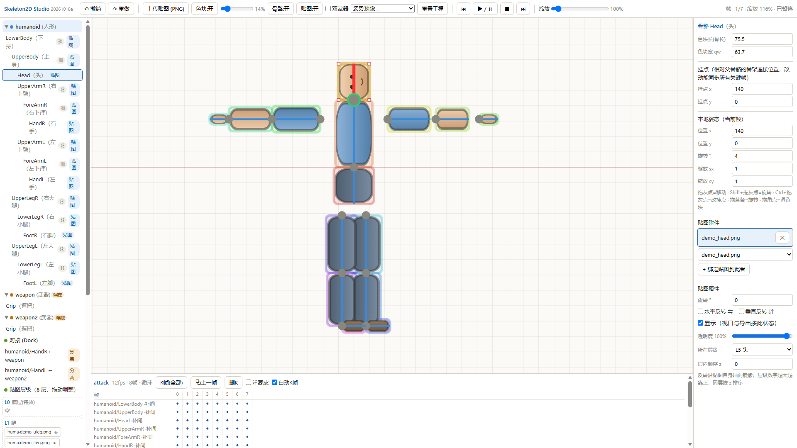
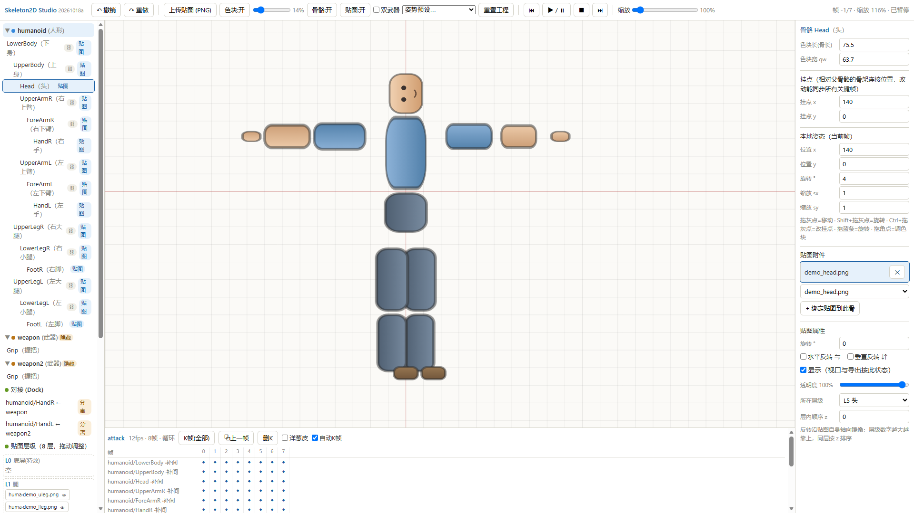
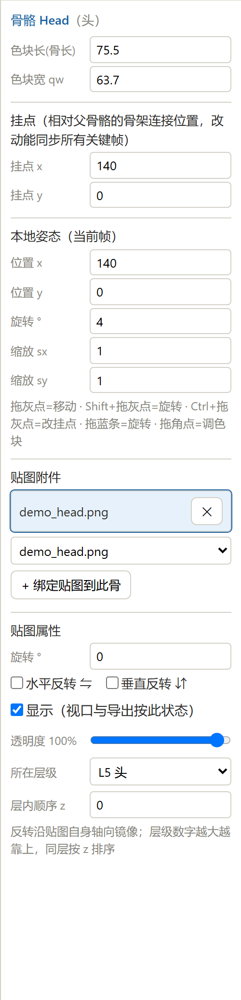
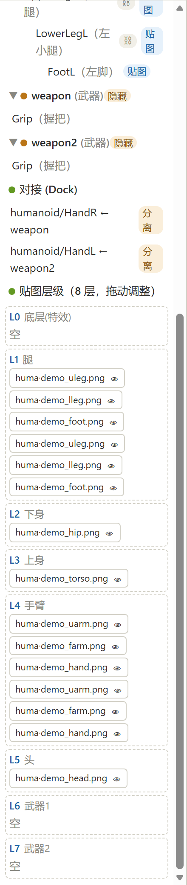
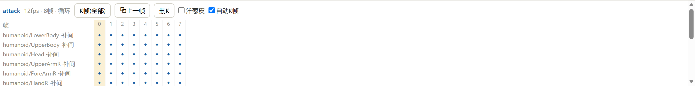

<div align="center">

# Skeleton2D Studio

**浏览器里的 Godot 4.x Skeleton2D 骨骼动画编辑器 —— 零依赖、导出即用**

*A browser-based Skeleton2D skeletal animation editor for Godot 4.x — zero dependencies, export-ready.*

[中文](#中文) · [English](#english)



</div>

---

# 中文

## 这是什么

**Skeleton2D Studio** 是一个运行在浏览器里的 2D 骨骼动画制作工具，专门为 **Godot 4.x 的 Skeleton2D 工作流**设计。

传统流程里，把一张立绘拆成部件、绑到骨骼、逐帧摆姿势、再导出成 Godot 场景，需要在多个工具之间来回倒腾。Skeleton2D Studio 把这条链路压缩到一个页面里：

> 上传部件贴图 → 绑到骨骼 → 拖拽摆姿势 → K 关键帧 → 导出 ZIP → 解压进 Godot 直接播放

导出的 `.tscn` 是**纯场景文件**（Skeleton2D + Bone2D + Sprite2D + AnimationPlayer），**不需要任何运行时代码或插件**。

整个项目零 npm 依赖：一个静态页面 + 一个 80 行的 Node 静态服务器。

## 核心特性

| 能力 | 说明 |
|---|---|
| **零依赖** | 无 npm 包、无构建步骤、无框架。原生 ES Module + Canvas 2D |
| **人形模板** | 内置 15 骨正面人形（下身/上身/头 + 双臂三段 + 双腿三段），开箱即用 |
| **武器与挂接** | 单段武器 `Grip` 骨骼模板，支持双手双武器；可**挂接**到指定手骨，也可**分离**成独立场景做御剑 / 悬浮武器 |
| **贴图锁定骨骼框** | 贴图自动拉伸铺满所属骨骼的色块框，边框严格对齐；改骨骼框 → 贴图同步缩放，不会错位 |
| **8 层贴图层级** | 底层特效 / 腿 / 下身 / 上身 / 手臂 / 头 / 武器1 / 武器2，拖动卡片即可改层级 |
| **单张贴图属性** | 旋转、水平反转、垂直反转、显隐、透明度、所在层级、层内顺序 z，全部所见即所得 |
| **逐帧动画** | 时间轴 + 自动 K 帧 + 步进模式（无补间），也支持单轨道切换为补间 |
| **姿势预设** | 8 套可直接套用的循环动作：待机、奔跑、攻击、跳跃、受击、倒地、后撤步、冲刺 |
| **洋葱皮** | 显示上一帧幽灵骨架，便于对齐逐帧动作 |
| **导出 Godot** | 一键导出 ZIP：`.tscn` + 贴图 + `meta.json`，含合并 / 分离两种模式 |
| **帧图导出** | 当前帧 PNG（透明背景）、PNG 序列图（自定义行列网格）、GIF 动图 |
| **自动保存双保险** | localStorage + 本机服务端磁盘 `.autosave/`；预览环境 localStorage 不持久时，刷新自动从磁盘恢复 |
| **撤销 / 重做** | 覆盖骨骼编辑、贴图属性、层级调整、关键帧操作 |
| **零依赖导出验证** | 自带脚本调用本机 Godot 4.x，实际加载导出的场景并播放全部动画 |

## 界面

三栏布局，中间是视口 + 时间轴：



左侧是**骨架树**（含武器、Dock 挂接、8 层贴图层级），右侧是**属性面板**，底部是**时间轴**。

### 属性面板

选中骨骼后，除了骨骼几何与当前帧姿态，还能直接管理挂在它身上的贴图：



「贴图属性」区就是单张贴图的全部可调项：旋转、水平/垂直反转、显隐、透明度、所在层级、层内顺序。

### 骨架树与贴图层级



层级数字越大越靠上；同一层内按 `z` 排序。实际显示顺序与导出到 Godot 的 `z_index` 使用同一公式（`层 × 100 + z`），所见即所得。

### 时间轴



每一行是一根骨骼的轨道，圆点是关键帧，行尾标注「步进 / 补间」。默认逐帧工作流（步进），适合手绘动画；需要平滑过渡时单轨切换为补间。

## 快速开始

### 环境

- **Node.js 18+**（仅用于本地静态服务与自动保存接口）
- 现代浏览器（Chrome / Edge / Firefox / Safari 近两年版本）
- 可选：**Godot 4.x**（仅在跑导出验证脚本时需要）

### 方式一：Windows 双击启动

项目根目录的 `start.cmd` 会自动：

1. 查找可用的 Node.js 运行时（系统 PATH → 安装目录，找不到会提示）
2. 检查 8788 端口是否已被占用（占用则直接打开浏览器）
3. 启动本地服务，2 秒后自动打开 `http://localhost:8788/`

关闭窗口即停止服务。

### 方式二：命令行

```bash
# 在项目根目录
npm run serve        # 等价于 node serve.mjs
```

然后浏览器打开 <http://localhost:8788/>。

> 无需 `npm install` —— 项目没有任何第三方依赖。

## 工作流

### 1. 上传贴图

工具栏「上传贴图 (PNG)」可多选导入。图片会自动降采样到长边 ≤ 1024px，避免大图拖慢保存与撤销历史。

### 2. 绑定贴图

1. 左侧骨架树选中骨骼（例如 `Head`）
2. 右侧「贴图附件」选择图片 → 点「+ 绑定贴图到此骨」
3. 贴图立刻贴合该骨骼的色块框；随后可调**旋转 / 水平反转 / 垂直反转 / 显隐 / 透明度 / 层级 / z**

同一根骨骼可以挂多张贴图（例如表情切换），列表顶部会用下拉框切换当前编辑对象。

**为什么贴图要锁定骨骼框？** 这样调整角色体型时（拖骨骼角点改长度/宽度），贴图会自动跟着缩放，不需要逐张重调，也不会出现贴图飘出色块的情况。

### 3. 摆姿势

在视口里直接拖拽：

| 操作 | 效果 |
|---|---|
| 拖**灰色关节圆点** | 移动该骨骼位置（改挂点） |
| 拖**骨骼蓝条** | 绕父关节旋转 |
| 拖**白色角点**（选中骨骼的 4 个角） | 调骨骼长 / 色块宽，贴图跟着缩放 |
| 按住 **Shift** 再拖 | 灰点 / 蓝条行为互换 |
| 右键拖拽 | 平移视图 |
| 滚轮 | 缩放视图（20% ~ 1000%） |

### 4. 做动画

- 选帧 → 摆姿势 → 点「**K 帧(全部)**」（勾选「自动 K 帧」时拖完即写入）
- 或点「**⧉ 上一帧**」复制上一帧姿态再微调 —— 适合逐帧手绘式工作流
- 「洋葱皮」显示上一帧幽灵骨架用于对齐
- 也可从工具栏「姿势预设」一键套用 8 套循环动作，作为二次创作的基础

### 5. 导出

右侧「导出」区：

| 产物 | 说明 |
|---|---|
| **导出 ZIP（Godot 直接可用）** | `.tscn` 场景 + 贴图 + `meta.json` |
| **当前帧 PNG** | 透明背景，按当前视口所见（可关色块/骨骼/贴图） |
| **PNG 序列图** | 自定义行列，把所有帧拼成一张精灵表 |
| **GIF 动图** | 全部帧，透明背景（GIF 只支持全透/不透明） |
| **工程文件 (.json)** | 跨机器备份 / 迁移 |

导出模式两种：

- **人形 + 武器合并（单场景）** —— 武器骨并入人形，`Grip` 成为 `HandR` 的子骨，打开就是一个完整角色
- **分离导出（Marker2D 挂点）** —— 人形与武器各自独立场景，手部带 `Dock_HandR` 标记点，运行时挂接：

```gdscript
var weapon = preload("res://weapon.tscn").instantiate()
$Humanoid/LowerBody/UpperBody/UpperArmR/ForeArmR/HandR/Dock_HandR.add_child(weapon)
```

## 导出产物结构

```
godot-export-attached.zip
├── humanoid.tscn          # Skeleton2D + Bone2D × N + Sprite2D + AnimationPlayer
├── textures/
│   └── *.png
└── meta.json              # 挂点信息：Marker2D 名称与偏移
```

- 动画**内嵌**在 `.tscn` 的 `AnimationPlayer` 里（不额外生成 `.tres`）
- 贴图的 `position / rotation / scale / flip_h / flip_v / self_modulate(alpha) / z_index` 全部写入 `Sprite2D` 节点
- 隐藏的贴图不导出（按所见状态）

## 快捷键

| 键 / 操作 | 功能 |
|---|---|
| `空格` | 播放 / 暂停 |
| `←` / `→` | 上一帧 / 下一帧 |
| `Ctrl + Z` | 撤销 |
| `Ctrl + Y` | 重做 |
| `Shift` + 拖拽 | 关节移动 / 骨骼旋转行为互换 |
| 右键拖拽 | 平移视口 |
| 滚轮 | 缩放视口 |
| `Shift` + 点击关键帧 | 删除该关键帧 |

## 目录结构

```
skeleton2d-studio/
├── index.html              入口（单页，三栏布局）
├── serve.mjs               零依赖静态服务 + 自动保存 API
├── start.cmd               Windows 一键启动
├── src/
│   ├── main.js             应用主体：状态、选中、编辑、K 帧、导出编排
│   ├── core/
│   │   ├── model.js        数据模型、2D 仿射矩阵、骨骼模板、层级规则
│   │   └── presets.js      8 套姿势预设（循环关键帧）
│   ├── render/
│   │   └── viewport.js     Canvas 绘制（色块/骨骼/贴图/手柄）+ 命中测试
│   ├── ui/
│   │   ├── tree.js         骨架树 + Dock + 8 层贴图层级面板
│   │   ├── inspector.js    属性面板（动态表单）
│   │   └── timeline.js     时间轴与关键帧矩阵
│   ├── export/
│   │   ├── tscn.js         Godot .tscn 场景生成
│   │   ├── zip.js          零依赖 ZIP 打包
│   │   └── gif.js          零依赖 GIF 编码
│   └── style.css
├── tools/                  导出验证、CDP 端到端测试、README 截图脚本
└── docs/images/            README 配图
```

## 技术实现

几个值得一提的设计点：

1. **矩阵驱动的骨骼系统**
   每根骨骼持有一个局部 `TRS` 矩阵，世界矩阵沿父链累乘；视口渲染、命中测试、导出坐标全部走同一套矩阵，避免"所见非所得"。

2. **贴图与骨骼框共用一套适配公式**
   视口绘制与 `.tscn` 导出都按 `长度 × 色块宽` 计算缩放，含旋转 ≈90° 时的宽高轴互换，因此导出的 Sprite2D 与编辑器内完全一致。

3. **零依赖的 ZIP / GIF 编码**
   `zip.js` 用 STORE（不压缩）+ CRC32 手工打包，`gif.js` 自己做调色板量化与 LZW 编码 —— 整个项目不需要任何第三方库。

4. **自动保存双保险**
   编辑后 300ms 防抖写入 localStorage，同时 POST 到本地服务端写入 `.autosave/project.json` 与 `textures.json`。iframe 预览等 localStorage 不持久的环境，刷新后仍能从磁盘恢复。

5. **导出闭环验证**
   `npm run validate` 会构建样例工程 → 导出两种模式 → 调用本机 Godot（`--headless --import` + 校验脚本）实际加载场景并播放全部动画，把"能导出"变成"能跑起来"。

```bash
npm run validate                     # 使用默认 Godot 路径
GODOT_PATH=/path/to/godot npm run validate
```

## 已知限制

- **需要本地服务**：自动保存依赖 Node 端的 `/api/save`。纯静态托管（如 GitHub Pages）仍可打开使用，但只有 localStorage 保存，刷新后数据依赖浏览器存储。
- **无图集打包**：每张贴图独立成 PNG，尚未合并成 atlas。
- **无 IK / 约束**：纯 FK 摆姿势，适合逐帧手绘动画，不做反向动力学求解。
- **GIF 透明度**：GIF 格式只支持全透明/不透明，半透明色块会以原色不透明近似呈现；需要半透明请用 PNG 序列图。
- **动画内嵌 `tscn`**：目前不生成独立 `.tres` 动画资源。

## 许可

本项目当前**未指定开源许可证**。公开发布前建议补充 `LICENSE` 文件（MIT 或 Apache-2.0 都是常见选择），否则默认保留所有权利，他人无法合法复用。

---

# English

## What is this

**Skeleton2D Studio** is a browser-based 2D skeletal animation editor built specifically for the **Godot 4.x Skeleton2D workflow**.

Cutting up a character illustration, binding the pieces to bones, posing frame by frame, and turning that into a Godot scene normally means bouncing between several tools. Skeleton2D Studio collapses that pipeline into a single page:

> Upload part textures → bind to bones → drag to pose → key frames → export ZIP → unzip into Godot and play

The exported `.tscn` is a **plain scene file** (Skeleton2D + Bone2D + Sprite2D + AnimationPlayer) — **no runtime script, no plugin, no addon required**.

The project has zero npm dependencies: a static page plus an 80-line Node static server.

## Features

| Capability | Details |
|---|---|
| **Zero dependencies** | No npm packages, no build step, no framework. Native ES modules + Canvas 2D |
| **Humanoid template** | Built-in 15-bone front-facing rig (lower body / upper body / head + 3-segment arms + 3-segment legs) |
| **Weapons & docking** | Single-bone `Grip` weapon template, dual-wield support; can be **attached** to a hand bone or **detached** as an independent scene for floating / telekinetic weapons |
| **Textures locked to bone quads** | Textures stretch to fill the owning bone's quad with edges aligned; resize the quad and the texture rescales with it |
| **8 texture layers** | FX / legs / lower body / upper body / arms / head / weapon 1 / weapon 2 — drag cards to reorder |
| **Per-texture properties** | Rotation, flip horizontal, flip vertical, visibility, opacity, layer, in-layer z — all live |
| **Frame-by-frame animation** | Timeline with auto-key and stepped mode, with optional tweened tracks |
| **Pose presets** | 8 loopable motions: idle, run, attack, jump, hurt, dead, backstep, dash |
| **Onion skin** | Ghost skeleton of the previous frame for alignment |
| **Godot export** | One-click ZIP: `.tscn` + textures + `meta.json`, in merged or detached mode |
| **Frame image export** | Current-frame PNG (transparent), PNG sprite sheet (custom grid), animated GIF |
| **Dual autosave** | localStorage plus on-disk `.autosave/`; recovers from disk when localStorage is not persistent |
| **Undo / redo** | Covers bone edits, texture properties, layer changes, keyframes |
| **Export validation** | Bundled script drives a local Godot 4.x install to actually load the exported scenes and play all animations |

## Interface

Three-column layout with the viewport and timeline in the middle:


Skeleton tree on the left (rigs, docking, 8 texture layers), inspector on the right, timeline along the bottom.

### Inspector

Selecting a bone exposes its geometry, current-frame pose, and the textures bound to it:


The "Texture properties" block is the complete per-texture control set: rotation, flip H/V, visibility, opacity, layer, in-layer z.

### Skeleton tree and texture layers


Higher layer numbers draw on top; within a layer, ordering follows `z`. Viewport order and the exported Godot `z_index` share one formula (`layer × 100 + z`), so what you see is what you export.

### Timeline


Each row is one bone's track, dots are keyframes, and the row label shows `stepped` or `tweened`. The default workflow is stepped frame-by-frame animation, which suits hand-drawn motion; switch a track to tweened when you need interpolation.

## Quick start

### Requirements

- **Node.js 18+** (only for the local static server and autosave endpoint)
- A modern browser (Chrome / Edge / Firefox / Safari from the last couple of years)
- Optional: **Godot 4.x** (only for the export validation script)

### Option 1 — Windows one-click

`start.cmd` in the project root will:

1. Locate an available Node.js runtime (system PATH → install dirs; reports if missing)
2. Check whether port 8788 is already serving (if so, just opens the browser)
3. Start the server and open `http://localhost:8788/` after 2 seconds

Closing the window stops the server.

### Option 2 — command line

```bash
npm run serve        # same as: node serve.mjs
```

Then open <http://localhost:8788/>.

> No `npm install` needed — the project has no third-party dependencies.

## Workflow

### 1. Upload textures

Use the toolbar button "上传贴图 (PNG)" (multi-select supported). Images are automatically downscaled to a max edge of 1024 px to keep saves and undo history responsive.

### 2. Bind textures to bones

1. Select a bone in the skeleton tree (e.g. `Head`)
2. Pick an image under "Texture attachments" and click "+ Bind texture to this bone"
3. The texture immediately fills that bone's quad; then adjust **rotation / flip H / flip V / visibility / opacity / layer / z**

A single bone can carry several textures (expression swaps, for example); a dropdown at the top switches which one you are editing.

**Why are textures locked to the bone quad?** So that reshaping a character (dragging corner handles to change bone length / width) rescales every texture automatically — no per-texture re-tuning, and no textures drifting outside their quad.

### 3. Pose

Drag directly in the viewport:

| Action | Effect |
|---|---|
| Drag a **grey joint dot** | Move the bone (edit its attachment point) |
| Drag the **bone bar** | Rotate around the parent joint |
| Drag a **white corner handle** (4 handles of the selected bone) | Change bone length / quad width; textures follow |
| Hold **Shift** while dragging | Swap joint-move and bone-rotate behaviour |
| Right-drag | Pan the view |
| Mouse wheel | Zoom (20% – 1000%) |

### 4. Animate

- Pick a frame → pose → click "**K 帧(全部)**" (key all). With "自动 K 帧" (auto-key) on, posing writes keys immediately
- Or click "**⧉ 上一帧**" (copy previous frame) and refine — a frame-by-frame, hand-drawn style workflow
- Enable "洋葱皮" (onion skin) to see the previous frame as a ghost
- Or apply one of the 8 pose presets from the toolbar as a starting point

### 5. Export

The export panel offers:

| Output | Notes |
|---|---|
| **Export ZIP (Godot-ready)** | `.tscn` scene + textures + `meta.json` |
| **Current frame PNG** | Transparent background, exactly as displayed (quads / bones / textures can be toggled) |
| **PNG sprite sheet** | Custom rows × columns grid of all frames |
| **Animated GIF** | All frames, transparent background (GIF only supports fully transparent or opaque) |
| **Project file (.json)** | Cross-machine backup / migration |

Two export modes:

- **Merged (single scene)** — the weapon bone is folded into the humanoid rig, `Grip` becomes a child of `HandR`; one scene is a complete character
- **Detached (Marker2D anchors)** — humanoid and weapon are separate scenes, the hand carries a `Dock_HandR` marker, attached at runtime:

```gdscript
var weapon = preload("res://weapon.tscn").instantiate()
$Humanoid/LowerBody/UpperBody/UpperArmR/ForeArmR/HandR/Dock_HandR.add_child(weapon)
```

## Export layout

```
godot-export-attached.zip
├── humanoid.tscn          # Skeleton2D + Bone2D × N + Sprite2D + AnimationPlayer
├── textures/
│   └── *.png
└── meta.json              # dock anchors: Marker2D names and offsets
```

- Animations are **embedded** in the `.tscn`'s `AnimationPlayer` (no separate `.tres`)
- Each texture's `position / rotation / scale / flip_h / flip_v / self_modulate(alpha) / z_index` is written onto its `Sprite2D`
- Hidden textures are skipped (export matches what you see)

## Keyboard shortcuts

| Key / action | Function |
|---|---|
| `Space` | Play / pause |
| `←` / `→` | Previous / next frame |
| `Ctrl + Z` | Undo |
| `Ctrl + Y` | Redo |
| `Shift` + drag | Swap joint-move / bone-rotate behaviour |
| Right-drag | Pan viewport |
| Mouse wheel | Zoom viewport |
| `Shift` + click keyframe | Delete that keyframe |

## Project layout

```
skeleton2d-studio/
├── index.html              Entry point (single page, three-column layout)
├── serve.mjs               Zero-dependency static server + autosave API
├── start.cmd               Windows one-click launcher
├── src/
│   ├── main.js             App core: state, selection, editing, keying, export orchestration
│   ├── core/
│   │   ├── model.js        Data model, 2D affine matrices, rig templates, layer rules
│   │   └── presets.js      8 pose presets (loopable keyframes)
│   ├── render/
│   │   └── viewport.js     Canvas drawing (quads / bones / textures / handles) + hit testing
│   ├── ui/
│   │   ├── tree.js         Skeleton tree + docking + 8-layer texture panel
│   │   ├── inspector.js    Property panel (dynamic form)
│   │   └── timeline.js     Timeline and keyframe matrix
│   ├── export/
│   │   ├── tscn.js         Godot .tscn scene generation
│   │   ├── zip.js          Zero-dependency ZIP writer
│   │   └── gif.js          Zero-dependency GIF encoder
│   └── style.css
├── tools/                  Export validation, CDP end-to-end tests, README screenshot script
└── docs/images/            README assets
```

## Implementation notes

A few design decisions worth calling out:

1. **Matrix-driven skeleton**
   Every bone holds a local TRS matrix; world matrices accumulate down the parent chain. Viewport rendering, hit testing, and export all use the same matrices, so there is no "looks right but exports wrong".

2. **One fitting formula for textures and bone quads**
   Both the viewport and the `.tscn` writer derive scale from `length × quad width`, including the axis swap when rotation is near 90°. Exported `Sprite2D` nodes therefore match the editor exactly.

3. **Hand-rolled ZIP and GIF coders**
   `zip.js` writes STORE (uncompressed) entries with a CRC32 table; `gif.js` implements palette quantisation and LZW itself. No third-party library anywhere in the project.

4. **Two-tier autosave**
   Edits are debounced (300 ms) into localStorage and simultaneously POSTed to the local server, which writes `.autosave/project.json` and `textures.json`. In embedded iframe previews where localStorage is not persistent, a refresh still restores the project from disk.

5. **Closed-loop export validation**
   `npm run validate` builds a sample project, exports both modes, then drives a local Godot install (`--headless --import` plus a verification script) to actually load the scenes and play every animation — turning "it exports" into "it runs".

```bash
npm run validate                     # uses the default Godot path
GODOT_PATH=/path/to/godot npm run validate
```

## Known limitations

- **A local server is required for autosave.** On pure static hosting (e.g. GitHub Pages) the app still runs, but only localStorage persists; a refresh depends on browser storage.
- **No texture atlas.** Each texture is exported as its own PNG.
- **No IK or constraints.** Pure FK posing, aimed at frame-by-frame hand-drawn animation.
- **GIF transparency.** GIF supports only fully transparent or opaque pixels; semi-transparent quads are approximated as opaque. Use the PNG sprite sheet when alpha matters.
- **Animations are embedded in `.tscn`.** No standalone `.tres` animation resources yet.

## License

This project currently has **no license specified**. Before publishing publicly, add a `LICENSE` file (MIT and Apache-2.0 are common choices); absent a license, all rights are reserved by default and others may not legally reuse the code.
